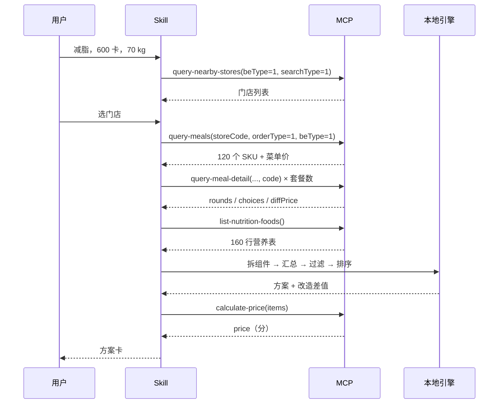

# MCP 集成说明

> 本项目接入麦当劳中国官方 MCP，用它取数、核价；所有计算在本地完成，模型不参与算术。
> 实测环境：2026-10-17，门店 3450212，到店自取（`orderType=1` / `beType=1`）。

---

## 1. 接入方式

| 项 | 值 |
|---|---|
| 端点 | `https://mcp.mcd.cn` |
| 协议 | Streamable HTTP |
| 鉴权 | `Authorization: Bearer <MCD_MCP_TOKEN>` |
| Token 申请 | https://open.mcd.cn/mcp → 手机号登录 → 控制台 → 激活 |
| 限流 | 600 次/分钟，超限返回 429 |
| 实测工具数 | **35 个**（官方 README 列 33 个）；`serverInfo: mcd-mcp 1.0.0` |

客户端配置：

```json
{
  "mcpServers": {
    "mcd-mcp": {
      "type": "streamablehttp",
      "url": "https://mcp.mcd.cn",
      "headers": { "Authorization": "Bearer YOUR_MCP_TOKEN" }
    }
  }
}
```

Token 只从环境变量读取，仓库内无任何凭证。

---

## 2. 用到的工具

只调用 6 个只读工具，其余 29 个（下单、领券、抽奖、商城、派对）一律不碰。

| 工具 | 在本项目里的用途 | 必填参数 | 返回要点 |
|---|---|---|---|
| `query-nearby-stores` | 让用户选一家门店 | `beType`、`searchType` | 门店列表与 `storeCode` |
| `query-meals` | 取当店在售 SKU 与价格 | `storeCode`、`orderType`、`beType` | `meals` 为字典，键是商品 code |
| `query-meal-detail` | **核心**：把套餐拆成轮次与选项 | 上面三个 + `code` | `rounds[].choices[]`，带 `diffPrice`、`isDefault`、`supportModify` |
| `list-nutrition-foods` | 官方营养表 | 无 | TOON 文本，160 行 × 9 列 |
| `calculate-price` | 最终核价 | 三个基础参数 + `items[]` | `price` 单位是**分** |
| `order-list` | 取历史门店 `storeCode` | 无 | 无历史订单时返回空列表 |

### 参数枚举

- `orderType`：`1` 到店（含得来速），`2` 外送。
- `beType`：`1` 到店取餐，`2` 麦乐送，`5` 得来速，`6` 企业团餐。
- 到店自取场景 `beCode` 为无效参数，传了会报错。

---

## 3. 调用顺序



三点约定：

1. **取数归 MCP，算术归脚本。** 组件求和、密度、差值全部由 `engine/core.py` 计算，模型只负责措辞。
2. **详情只对套餐类 SKU 拉。** 120 个 SKU 全拉约两分钟，交互不可接受；只对含「套餐 / 三件套 / 四件套 / 随心配」的约 41 个拉取，按 `storeCode + code` 落盘缓存。
3. **核价只在最终方案上做。** 每个候选都核价会打满限流。

---

## 4. 数据结构与映射

### 套餐详情

```
data.rounds[]                    选配轮次
  .name                          轮次名（主食 / 小食 / 饮料）
  .choices[]
    .code                        组件唯一编码，用于对营养表做二次查询
    .name                        组件名，当前只能靠它对营养表
    .isDefault                   1 表示默认选中
    .diffPrice                   "+ ¥2" / "- ¥0.5"，套餐内替换差价
    .supportModify               是否支持特调
    .modification.items[].values[]
      .code / .name / selectedQuantity   酱料、配料项
```

### 营养表

TOON 格式（不是 JSON，也不是 CSV）：

```
[160]{productName,nutritionDescription,energyKj,energyKcal,protein,fat,carbohydrate,sodium,calcium}:
  猪柳麦满分,null,1288,308,16,16,24,781,213
```

- 每份口径，不是每 100 g。
- 没有 `code` 列——这是本项目最大的工程量来源。
- `nutritionDescription` 全部为 null。

### 价格

| 字段 | 含义 | 单位 |
|---|---|---|
| `meals[code].currentPrice` | 菜单价 | 元 |
| `choices[].diffPrice` | 套餐内替换差价 | 元（带符号） |
| `calculate-price.price` | 应付总额 | **分** |

---

## 5. 业务价值

MCP 把菜单、营养、价格、优惠开放成了原子接口，但**原子接口不解决决策**。用户站在点餐屏前的真实问题是一句话：「这份套餐怎么改才不超 600 卡」，需要跨三个接口做组件级对齐。

本项目在中间加了一层：

- 把 `query-meal-detail` 的选配树还原成可计算的结构；
- 把 160 行营养表按名称对齐到组件上，并如实记录对不上的部分；
- 把「换一个小食」翻译成四项可比较的差值；
- 用 `calculate-price` 兜底，保证展示价能对得上支付页。

结果是一个可复核的结论，而不是一段听起来合理的建议。

---

## 6. 实测记录与踩坑

| 现象 | 说明 |
|---|---|
| 不带 `Authorization` 返回 **403「系统错误」** | 不是 401。照文档排错会误判成服务故障，实际是网关在边缘拦了 |
| 带无效 Token 返回 401 | `当前鉴权码不存在或已失效` |
| `query-meals` 只传 `storeCode` 会报错 | 必须同时给 `orderType` 和 `beType` |
| 到店场景传 `beCode` 会报错 | schema 里明写「不要传，传了会报错」 |
| 营养表是 TOON 文本 | 按 JSON 解析会失败；行数在首行 `[160]{...}:` 里 |
| 营养表无 `code` 列 | 只能按名称对齐；菜单 120 SKU 中直接命中 18%，套餐待拆 34%，单品无营养 48% |
| 营养表有 2 组重名行 | `小杯玉米杯`、`纯牛奶（盒装）`，数值完全相同 |
| 4 行能量为 0 | 逐条核对后确认都是真零卡（无糖可乐三档 + 纯悦） |
| 服务端 35 个工具 | 比文档多 `query-survey-coupon`、`query-promotions` |
| 菜单价与核价一致 | 抽样 8 个套餐，`calculate-price` 与菜单价 8/8 一致（无券场景） |

完整实测数据见 `实测报告.md`，探针为 `probe/mcp_probe.py`。

---

## 7. 权限与安全边界

**会调用**：`query-nearby-stores`、`query-meals`、`query-meal-detail`、`list-nutrition-foods`、`calculate-price`、`order-list`。

**不会调用**：`create-order`、`cancel-order`、`auto-bind-coupons`、`draw-lottery`、`mall-create-order`、`party-order-create`、`delivery-create-address`。

代码层面用白名单外的黑名单硬拒，见 `probe/mcp_probe.py` 的 `FORBIDDEN` 集合。

其他约定：

- Token 只存环境变量，不写文件、不进日志、不回显。
- 用户体重只在本机内存中使用，不上传。
- 展示价格必须经核价；未核价时明确写「菜单价」。

---

## 8. 失败与降级

| 情况 | 处理 |
|---|---|
| 401 | 提示重置 Token |
| 403 + `code 0001` | 提示检查 `Authorization` 头 |
| 429 | 降低调用频率，详情走缓存 |
| 门店无菜单 | 提示换店，不进入推荐 |
| 营养缺失 | 标 `partial`，只报已知部分 |
| 核价失败 | 展示菜单价并标注「未核价」 |

---

## 9. 快照与版本

- 菜单与详情快照时间写在 `engine/data/menu.json` 的 `fetchedAt`，页面脚注同步展示。
- 营养表随项目内置，`python engine/sync.py --force` 可刷新。
- 价格与可售状态以官方实时结果为准，快照仅用于离线演示。
