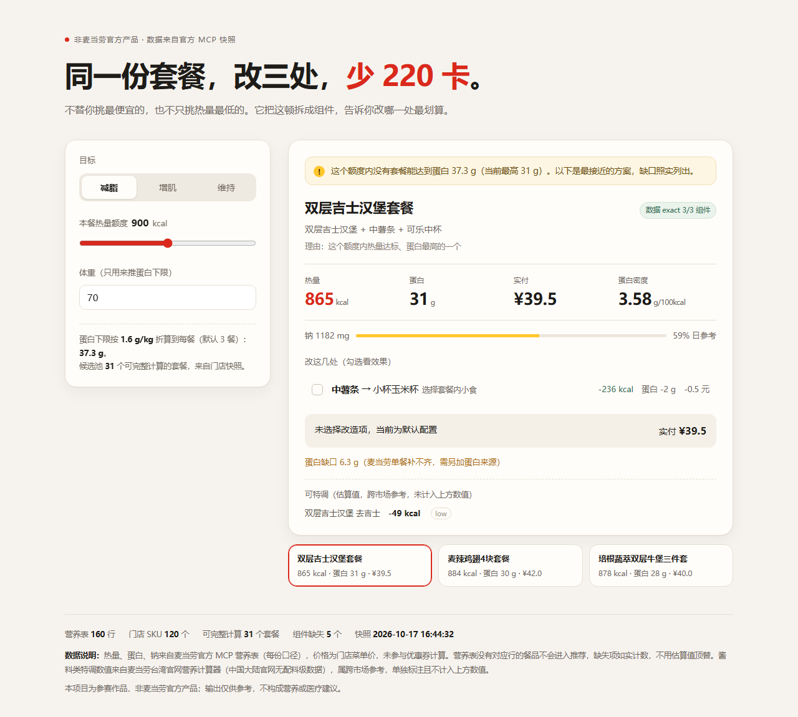

# 麦当劳热量改造器

> **同一份套餐，改三处，少 220 卡。**

市面上的麦当劳工具都在回答「一单怎么点最便宜」或「吃哪个热量最低」。
这个项目回答另一个问题：**你手里这份，怎么改。**

它把套餐拆成组件，逐个算热量、蛋白、钠和差价，然后告诉你改哪一处最划算、代价多少。
数据全部来自麦当劳中国官方 MCP，不猜、不估、不发明。



<p align="center">
  免安装 · 免 Token · 无网络请求<br>
  把 <code>demo/index.html</code> 下载到本地，双击打开即可
</p>

---

## 一个真实结果

```
【减脂 · 本餐】额度 900 kcal · 蛋白目标 37.3 g
────────────────────────────────────────
⚠ 这个额度内没有套餐能达到蛋白 37.3 g（当前最高 31 g）。以下为最接近的方案，缺口照实列出。

推荐：双层吉士汉堡套餐
理由：这个额度内热量达标、蛋白最高的一个
组成：双层吉士汉堡 + 中薯条 + 可乐中杯
实付 ¥39.5（菜单价）· 热量 865 kcal · 蛋白 31 g
蛋白密度 3.58 g/100kcal · 钠 1182 mg（59% 日参考）
数据：exact 3/3 组件

改这 1 处：
1. 中薯条→小杯玉米杯  -236 kcal  -2 g 蛋白  -164 mg 钠  -0.5 元

改完：629 kcal · 蛋白 29 g · ¥39.0
蛋白缺口 8.3 g（麦当劳单餐补不齐，需另加蛋白来源）
```

这组数字来自真实门店快照，可用 `python engine/cli.py plan --mode cut --kcal 900 --weight 70` 复现。

---

## 它和别的麦当劳 Skill 差在哪

| | 常见的点餐助手 | 这个项目 |
|---|---|---|
| 回答的问题 | 吃什么 | **这份怎么改** |
| 输出 | 一个方案 | 方案 + 改动清单 + 每处改动的四项差值 |
| 数据粒度 | 套餐级 | **组件级**（套餐拆到主食/小食/饮料） |
| 价格 | 菜单价或估算 | 官方差价 `diffPrice`，整单可核价 |
| 做不到的时候 | 换一个推荐 | **如实报缺口，不硬凑** |
| 人群 | 泛用户 | 减脂 / 增肌 / 维持，三档参数 |

差异落在「改造」这件事有没有被量化。榜单里的热量类作品大多在做「挑一份」，少见有人算「改一处」。

---

## 三个模式

| 模式 | 热量约束 | 蛋白下限 | 排序依据 |
|---|---|---|---|
| 减脂 | ≤ 本餐额度 | 1.6 g/kg ÷ 餐次 | 蛋白密度（g/100kcal） |
| 增肌 | ≤ 本餐额度 | 1.8 g/kg ÷ 餐次 | 蛋白性价比（g/元） |
| 维持 | 目标 ±10% | 不设 | 与额度最接近 |

蛋白下限是**硬约束**。做不到时不会偷偷放宽，而是降级到「热量达标里蛋白最高」的方案，并在卡片第一行说清楚。

内置 3 餐折算，不在本地推算基础代谢——那涉及个体差异与健康责任，额度由用户自己给。

---

## 数据边界：能算什么，不能算什么

这是本项目最想讲清楚的部分。官方营养表 160 行，菜单 120 个 SKU，两者只能按名称对齐。

| 情况 | 数量 | 占比 |
|---|---:|---:|
| 直接对上营养行 | 21 | 18% |
| 套餐，需拆成组件 | 41 | 34% |
| 单品，营养表没有 | 58 | 48% |

营养表里**没有任何一行是套餐**，所以套餐必须拆；拆完的组件再按名字对齐。最终：

- 可完整计算（exact）的套餐：**29 个**
- 组件级命中：**101 / 101**（其中 5 项靠别名表匹配）
- 因命名差异或营养缺失只能算部分（partial）：8 个

三类处理规则写死在代码里：

1. `exact` 才进推荐池，`partial` 只报「已知部分 + 缺失项」，**不给总数**。
2. 营养值为 0 的，只有白名单里那 4 条（无糖可乐三档 + 纯悦）保留 0，其余视为 unknown。
3. 命名差异走别名表（`原味双层深海鳕鱼堡` → `双层深海鳕鱼堡`），没收录的记 `unmapped`，不用近似值顶替。

> 一个诚实的结论：按 1.6 g/kg 算，麦当劳单餐基本达不到蛋白目标。原因在营养结构，不在推荐算法。

---

## 快速体验（不用 Token）

```bash
# 直接打开，无需安装
demo/index.html
```

页面里嵌了门店快照，切换模式、拖动额度、勾选改造项都会实时重算。

命令行同样可跑：

```bash
python engine/cli.py coverage     # 数据规模与覆盖率
python engine/cli.py list         # 29 个可完整计算的套餐
python engine/cli.py plan --mode cut --kcal 900 --weight 70
python engine/cli.py selftest     # 10 项离线验收
```

零第三方依赖，Python 3.9+。

想给它一个在线地址：仓库 Settings → Pages → Source 选 GitHub Actions，之后推送到 `main` 会自动把 `demo/` 发布成静态页（工作流见 `.github/workflows/pages.yml`）。

---

## 装成技能（WorkBuddy）

本仓库根目录就是技能本体，`SKILL.md` 在根上。

```bash
git clone <repo> ~/.workbuddy/skills/mcd-calorie-remodel
```

或在 WorkBuddy 左侧【专家·技能·连接器】→【技能】→【添加技能】上传本仓库。

装好后说「减脂期麦当劳怎么点」「巨无霸三件套怎么改」即可触发。

---

## 接入真实数据

### 1. 申请 MCP Token

前往 [open.mcd.cn/mcp](https://open.mcd.cn/mcp)，手机号登录 → 右上角「控制台」→ 激活 → 复制 Token。

```bash
export MCD_MCP_TOKEN="你的 Token"     # PowerShell: $env:MCD_MCP_TOKEN="..."
```

Token 只从环境变量读取，仓库里没有任何凭证。

### 2. 在客户端连上 MCP

```json
{
  "mcpServers": {
    "mcd-mcp": {
      "type": "streamablehttp",
      "url": "https://mcp.mcd.cn",
      "headers": { "Authorization": "Bearer YOUR_MCP_TOKEN" }
    }
  }
}
```

### 3. 同步门店快照

```bash
python engine/sync.py            # 拉当前账号历史门店的菜单 + 套餐详情
python engine/sync.py --store-code 3450212 --force
```

菜单与套餐详情落盘缓存，`--force` 可全量重拉。

### 4. 核验价格口径

```bash
python engine/verify.py --limit 8
```

逐个调官方 `calculate-price`，与菜单价对比。当前快照抽样 8 个套餐，**8/8 一致**。

---

## 怎么工作


三条工程规则：

1. **先过硬约束，再排优先级。** 不用排序结果反推约束。
2. **减脂只做减法，增肌只做加法。** 两个方向不进同一张卡。
3. **不做全枚举。** 一份套餐的选项是 7 × 25，全排列上千种；只对每轮的替换项逐个算差值，最多输出 3 条。

减脂模式还限制累计降幅不超过原热量的 30%、改后不低于 400 kcal、蛋白密度不得下降——避免把一顿饭砍到不合理。

---

## 目录

```
├── SKILL.md              技能定义（WorkBuddy 加载）
├── MCP_INTEGRATION.md    用了哪些工具、调用顺序、踩坑记录
├── CONTEST_DECLARATION.md 官方参赛声明（原文，未改动）
├── demo/
│   ├── index.html        单文件演示（146 KB，零外链）
│   ├── build.py          把引擎快照裁剪内嵌
│   └── template.html     页面源码
├── engine/
│   ├── sync.py           同步 MCP 快照
│   ├── core.py           对齐 / 汇总 / 打分 / 求解 / 改造 / 渲染
│   ├── cli.py            命令行入口
│   ├── verify.py         用 calculate-price 核验菜单价
│   └── data/             菜单、营养表、40 份套餐详情、别名表、因子表、白名单
├── probe/
│   └── mcp_probe.py      MCP 实测探针（35 工具、返回结构、覆盖率）
├── 产品需求手册.md
├── 竞品拆解.md
└── 实测报告.md
```

---

## 实测发现

开发过程中用真实 Token 联调得到的观察，已写进 `实测报告.md`：

- 服务端实际暴露 **35 个工具**（官方文档 33 个），参数签名以 `tools/list` 为准。
- `query-meals` / `query-meal-detail` / `calculate-price` **必须带** `orderType` + `beType`，只传 `storeCode` 会报错；到店场景传 `beCode` 会报错。
- 套餐详情返回 `rounds[].choices[]`，每个组件带独立 code 与 `diffPrice`（连 −¥0.5 这种负差价都有），这是改造层能算准的原因。
- 营养表是 TOON 文本（`[160]{...}:`），不是 JSON；`nutritionDescription` 全部为 null。
- 营养表有 2 组重名行（`小杯玉米杯`、`纯牛奶（盒装）`），数值完全相同，取第一条不影响结果。
- 菜单 `currentPrice` 与 `calculate-price` 抽样 8 个套餐全部一致；有券时以核价为准。
- 不带 `Authorization` 请求头时网关返回 **403「系统错误」**，不是 401——照文档排错会误判成服务故障。

---

## 明确不做

| 不做 | 原因 |
|---|---|
| 减重效果承诺 | 不可控，也有合规风险 |
| 血糖 / 疾病饮食建议 | 医疗边界，需资质 |
| 过敏原判断 | 无配料表，只能按名称粗筛，误判代价高 |
| 咖啡因含量 | 官方营养表无此维度 |
| 优惠券组合优化 | 省钱赛道已高度饱和，不重复造 |
| 单人之外的分账 | 多人优惠归属要重算，首版不做 |

### Roadmap

- [x] 命名对齐：别名表救回 5 个 partial（`原味双层鳕鱼堡`、`苹果片一袋(60g)`）
- [ ] 剩余 8 个 partial：当季新品（龙焰系列）与需要乘算的 `麦辣鸡翅4块`
- [ ] `factors.json` 补齐 5 项酱料因子，让「去酱」从占位变成可算
- [ ] 外送场景（选项与配送费会改变差值，需单独建模）
- [ ] 周预算额度

---

## 数据与合规

- 营养与价格来自麦当劳中国官方 MCP，快照时间写在页面脚注与 `engine/data/menu.json`。
- 特调因子表数值为空时不参与计算，宁可少说。
- Token 只存环境变量，不落盘、不进日志、不回显。
- 本项目为**麦当劳程序员创意开发大赛参赛作品，非麦当劳官方产品**。
- 输出仅供参考，不构成营养或医疗建议；餐品、价格与供应状态以官方渠道实时结果为准。

## 许可

MIT
